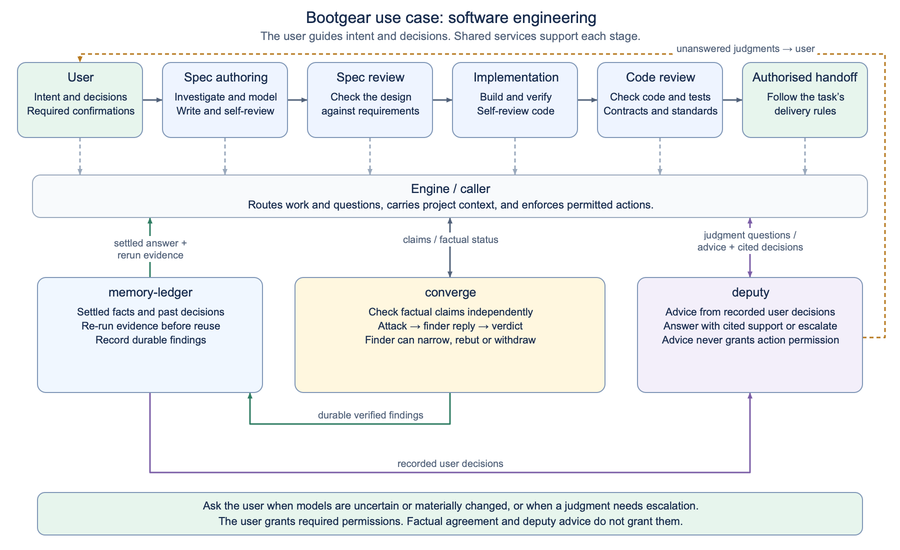

# bootgear

> An agent harness framework — the gear between the LLM motor and your skills, tools, configs, and docs.

## What is bootgear?

bootgear is a curated collection of general-purpose, extensible **skills**, **agents**, and **hooks** for coding-agent workflows.

Think of an LLM as a motor: raw power, no direction. A motor alone doesn't move anything — it needs a transmission that converts spin into motion, mounted on a chassis you can actually load your cargo onto. bootgear is that layer. It sits between the model and your assets, routes work through an opinionated loop, and lets you bolt on your own gear where it matters.

```
your skills / tools / configs / docs      <- what makes each project different
                  ^
                  |   bootgear: routing, invocation, governance
                  v
                   LLM                    <- the motor
```

## Design principles

**General by design.**
Framework-level skills and agents hold no project-specific knowledge. They are reusable across projects, languages, and teams.

**The framework drives (IoC).**
Inspired by Spring Boot: you don't call the framework, the framework calls you. Register your skills, agents, and hooks — bootgear owns the lifecycle and invokes them at the right points in the loop.

**Opinionated defaults, explicit overrides.**
Every component works out of the box with sensible defaults, and every component declares its customization points. Tune preferences, swap steps, or extend behavior without forking the skill.

**Your workflow stays yours.**
bootgear puts you inside a productive loop, not inside a black box. You always see which gear is engaged and can amend the run or stop it at any point.

## How is this different from [superpowers](https://github.com/obra/superpowers)?

superpowers proved that a strong, opinionated skill set makes agents dramatically more capable. But its opinions are take-it-or-leave-it: if a skill's assumptions don't fit your project or taste, your options are to live with it or fork it.

bootgear keeps the opinionated core but treats customizability as a first-class feature. Same idea — harness over raw model power — with the control handed back to you.

| | superpowers | bootgear |
|---|---|---|
| Opinionated defaults | Yes | Yes |
| Extension/customization points | No | Explicit, per component |
| Project-specific knowledge | Baked in where needed | None by design |

## Platforms

| Platform | Status |
|---|---|
| Claude Code | **cli, engine, converge, spec, test, review, advisor, memory-ledger, and deputy**, as plugins |
| opencode | Not shipped |
| Codex | The same plugins, skills, and command sources, with native manifests and hooks |

Both marketplaces load the same `plugins/<name>` directories.
Each shared skill selects its host mechanics explicitly.

## Architecture

Bootgear ships **host-native plugins**. The engine provides durable task
execution, state-machine governance, recall and recovery, and project-level
workflow configuration; project-specific skills and conventions stay in the
repository and are invoked natively by the host.

```
project skills / hooks / config
        │
        ▼
engine workflow + session ledger
        │
        ▼
Claude Code / Codex CLI plugins
```

Plugins are authored and loaded in their host's native format.

## Use case: software engineering

Bootgear can connect spec authoring, implementation and review in one engineering workflow.
The user supplies intent, resolves escalated questions and grants required permissions.
Project context supplies the domain rules and conventions.



Spec review checks the design. Code review checks the implementation, tests and contracts.
Shared support works across these stages:

| Gear | Role |
|---|---|
| [memory-ledger](plugins/memory-ledger) | Reuse settled answers after rerunning their evidence. Record durable findings. |
| [converge](plugins/converge) | Check factual claims through independent attacks, finder replies and verdicts. |
| [deputy](plugins/deputy) | Advise on judgment questions from recorded user decisions, or escalate them to the user. |

Factual agreement and deputy advice do not grant action permission.
The [SVG version](assets/software-engineering-use-case.svg) keeps the diagram editable.

## Repository layout

```
bootgear/
├── plugins/         # one authored source directory per plugin, with both native manifests
├── .claude-plugin/  # Claude Code marketplace
├── .agents/         # Codex marketplace
├── .bootgear/       # project workflow configuration
├── docs/            # current design
└── quality/         # repository validation and quality checks
```

Each plugin has `.claude-plugin/plugin.json` and `.codex-plugin/plugin.json`.
Both hosts use its shared skills and providers. Hook registrations retain each host's native contract.

## Install

On macOS, open Bootgear Setup from a terminal:

```sh
launcher="$(mktemp)" && curl -fsSL --max-time 120 https://raw.githubusercontent.com/vancsj/bootgear/main/setup-macos.sh -o "$launcher" && /bin/bash "$launcher"
```

Choose Claude Code or Codex, select your plugins, and choose Install.
Setup uses uv-managed Python 3.12 and prepares the shared Gear runtime.
Repair refreshes plugins and the runtime. Configure fills missing user settings.

If the CLI plugin is already installed, use cli:setup in your host session.
On success, restart your host sessions so they load the current plugins.
Use cli:gear to find the literal Gear path.

| gear | what it does |
|---|---|
| [cli](plugins/cli) | owns Gear, the shared Python runtime, clikit, discovery, and the public Gear-path skill |
| [memory-ledger](plugins/memory-ledger) | a ledger of settled questions, where confidence counts independent verifications instead of asserting itself |
| [engine](plugins/engine) | an autonomous task-execution loop — start a run with `/engine:start` (Codex: `$engine:start`); installs `converge`, `spec`, `test`, `review`, `advisor` and `memory-ledger` with it |
| [converge](plugins/converge) | settles the facts behind a findings slate: find, refute, and cut each claim with separate agents, then compute what is reported; installs `memory-ledger` and `advisor` with it, and is installed automatically with `engine` and `review` |
| [review](plugins/review) | PR review: lens finders and a gap hunt, with every finding settled through `converge`; installs `converge` with it |
| [spec](plugins/spec) | requirements and design for `engine`'s design-doc and ticket-to-pr runs. It works on its own too. |
| [test](plugins/test) | test writing, running, and failure triage for `engine`'s triage and ticket-to-pr runs; works on its own too |
| [advisor](plugins/advisor) | pairs Claude Code and Codex CLI through the coordination store or sends a one-shot request |
| [deputy](plugins/deputy) | answers a judgement question from your recorded decisions, or escalates it to you, and reminds the AI to ask it before it asks you; installs `memory-ledger` with it on Claude Code, and needs `memory-ledger` installed on Codex |

### Codex CLI

Use the launcher for first setup. To set up from an existing Codex CLI installation, use cli:setup.
The same installer prepares selected plugins and their declared dependencies.

Start an engine run with `$engine:start`. Set up the ledger with `$memory-ledger:setup`.
Trust plugin hooks through the native `/hooks` interface when Codex requests it.

`advisor` supports persistent advice and one-shot requests between Claude Code and Codex CLI.

## Status

bootgear ships as native Claude Code and Codex CLI plugins. The shared CLI
plugin routes registered commands through Gear: `<gear> --host <host> <plugin>
<command> [arguments]`.

## License

[Apache License 2.0](LICENSE). Contributions require a DCO sign-off — see
[CONTRIBUTING.md](CONTRIBUTING.md).
