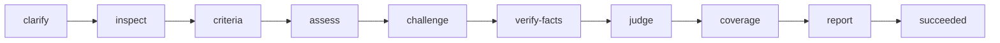

# Artefact review

Artefact review assesses documents, presentations, tickets and other outputs against their purpose and audience.
The workflow returns an evidence-linked quality report with explicit inspection limits.
Review completion does not grant publication approval.

## Workflow

Inspection records the audience, purpose, reader task, delivery mode and available representations.
Criteria selection fixes applicability before a fresh reviewer assesses the output.
A separate challenger checks the whole assessment, positive states, severity and missed defects.
Converge settles factual claims. Resolve or debate settles contested quality judgements.
Coverage accounts for every criterion, candidate and inspection limit before the report completes.

## Rubric and configuration

The default rubric covers audience fit, narrative, accuracy, completeness, readability and presentation access.
Supplied narration forms part of the presentation context.
Each criterion receives one state: Meets, Needs change, Cannot judge or Not applicable.
The report gives useful quality judgements without an aggregate score or readiness certificate.

User, project and task configuration can change criteria and finding angles.
Disabled entries need reasons. Reports disclose overrides and default, effective and input digests.
Typed evidence separates inspected material, narration, calculations, checked sources and unsupported memory.

## Enforcement boundary

The public task CLI binds inputs and configuration to a review revision.
Stage records bind their prerequisites, so upstream changes invalidate later records.
The state machine checks each forward exit through the matching stage gate.
Gates validate declarations, identities, references and dispositions.
Independent reviewers judge meaning and quality; a successful gate cannot prove either.

The review keeps supplied outputs unchanged.
Its complete report includes retained, dropped and uncertain candidates, evidence and limits.
Both hosts share the workflow, defaults and completion contract.
