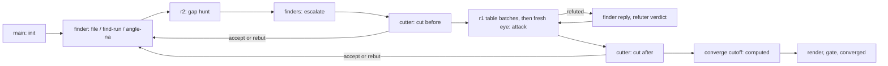

# converge

converge settles the **facts** behind a set of claims. Separate agents find each claim, attack
it, and cut it (rate how much it matters). A CLI validates every step against an
append-only ledger and computes which claims are findings. When the facts are agreed but a
decision remains, the claim carries a `choice` for `debate` (see [engine.md](engine.md)). A
factual dispute never goes to debate.

## Components

| Part | Role |
|---|---|
| `plugins/converge/src/converge/` | Python package with ledger I/O, event checks and replay, claim state, cutoff rules, and CLI command groups. |
| `plugins/converge/src/converge/angles/builtin.yaml` | Built-in `attack`, `evaluate` and `decide` angles |
| `plugins/converge/gear.toml` | Registers the Python command through Gear. |
| `plugins/converge/skills/converge/` | Orchestration skill (roles, steps, outcomes) |

Callers: `review` runs every finding through a slate; the engine `change-review` and
`ticket-to-pr` machines gate their `review` node on `converge gate`; the engine `triage`
machine gates its `triage-review` exit to `succeeded` on `converge gate --kind triage --report
<absolute file> --base-slate <first visit's slate>`, and a refusal goes back to `triage`; engine `debate` hands
factual disputes back, briefs parties with the render, and draws its closing angle round from
the `decide` and `attack` angles.

## Slates

A **slate** is one set of claims under test, and one task for the agent budget. Its id
matches `[a-z0-9][a-z0-9._-]{0,80}`. The caller gives the artifact, lenses and find-angle
files. Phases run in a fixed order: find → escalate → cut before → attack → cut after →
cutoff → done.

`init --snapshot --pass N` commits the work tree, untracked files included, through a
temporary index and pins it at `refs/converge/<slate>`. `--since <prev>` requires
`pass = prev.pass + 1`, records the previous snapshot and prints the `git diff` between the
two. From pass 2, `cutoff.rereview.lenses` is laid over `cutoff.lenses`: for each lens it
names, its rule lists replace that lens's, and the lens keeps its other lists; a lens with no
table of its own starts from `default`.
`converge prune` deletes the refs; engine `execute` prunes them before closing a run.

## Roles and angles



- **Declared agent ids** (`--as`). The base `caps.agents` budget defaults to 5 and includes
  the `init` writer. Each extra worker on an active seat adds one slot. The computed
  `converge` events are exempt. A claim's finder never attacks or cuts it, its refuters and cutters are
  disjoint, and only the finder may `reply`, `rebut` or `accept`. Ids are trusted as
  declared: the checks stop accidental self-judging, not a lying agent.
- **Allocation.** The default uses `main`, `finder`, `r1`, `r2`, and `cutter`.
  Parallel workers on a seat use its name followed by numbered IDs, such as `r1-2`.
  `r2` is also the gap-hunt finder (`origin: gap-hunt`) right after find
  coverage, and acts as finder for those claims. `init --refuters 1` or
  `steps.gap_hunt: false` turns the gap hunt off. Parallel slates use `gap-hunt-done` before escalation.
  The `r1` seat runs fixed batches. The `r2` seat runs fresh-eye.
  The `r1` seat also runs fresh-eye for gap-hunt claims and on slates with one refuter.
- **Seats.** Each seat a slate holds (`main`, `finder`, `r1`, `r2`, `cutter`) has a
  mechanism, `native_subagent` or `advisor`. `init --settlement <file>` reads
  `converge_seats` and `advisor_roles` from the engine settlement, re-checks the engine's
  rules (only `r2` may be `advisor`; `refuter` or `gap-hunter` needs
  `r2: advisor`) with a byte-identical copy of the engine's `seats.py`, and records the
  slate's `seats` and the advisor's `{roles, brief, startup}` plus its optional approved `launcher` in the `init` event. Without
  `--settlement`, or when the `init` event has no `seats`, every seat is `native_subagent`. An
  `advisor` `r2` with no advisor role takes `refuter` and `gap-hunter` and a stock brief, with
  a `NOTE`; a settlement `r2: advisor` on a slate without `r2` gets a `NOTE`, not a refusal.
- **Startup.** Early timing reclaims the run's existing pairing during initialization.
  Deferred timing lets finder work proceed and prepares the listener at its first assigned task.
  Recorded channels are reused; a failed pairing does not select a different mechanism.
- **Single advisor driver.** `init` and `status` print one background step to send a request and start a bounded receive.
  The driver sets the receive budget and the action for late replies.
  The request directs the advisor to write its own events with `--as r2`.
  The driver names the seat as blocked when a write is denied or required events are missing.
- **Parallel advisor driver.** The asker reserves one channel per worker under the review group.
  The approved launcher receives `{group}`, `{worker}`, and `{invitation}` as whole arguments.
  Gear waits for the exact listener. `advisor-wait` counts five quiet receives and resets on corresponding slate progress.
  Engine supplies its run ID with `--review-group`. A standalone continuation inherits the group through `--continue-from`.
- **Angles** are rows `{id, tag, tell, asks, field?, lens?, cost?}` with tag `find`,
  `attack`, `evaluate` or `decide`; `(tag, id)` is unique. The built-in table has no `find`
  rows; callers supply them, as review does. The resolved table is builtin + `--angles`
  files + config `angles.files`, minus `angles.disable`. `init` snapshots it, so later edits
  never change an open slate.
- **Coverage.** Every applicable find angle of every lens needs a `find-run` or an
  `angle-na` with a reason.

## Steps, attack and cut

- **Steps.** Config section `steps`: `escalate` and `gap_hunt` (booleans, on by default)
  and `cut` (`before`, `after`, `both` or `none`; default `both`).
- **Phase gate.** `status` reports the slate's phase: the first phase, in the order above,
  with an open item; a cut phase that `steps.cut` excludes is skipped. An event is accepted
  only in the phase of its kind and for a claim with an open item of that phase: `escalate`
  in escalate; `cut`, `accept` and `rebut` in the cut phase their `when` names; `attack`,
  `reply`, `verdict` and a claim-level `angle-na` in attack. `file` is refused once any
  `escalate`, `cut` or `attack` exists, `escalate` once any `cut` or `attack` exists. A
  killed or unverified claim takes no attack and no after cut.
- **Escalate.** Once per claim its finder records `escalate`: a `wider` text with
  `evidence` citing a concrete route to the worse outcome, or neither. A wider text replaces
  the claim text.
- **File.** A claim carries `loc`, `claim`, `trigger`, `evidence` and `tier`
  (`reproduced`, `traced` or `inferred`), plus optional `rule` and `depends`.
- **Cut dimensions.** Every cut sets `impact` (`security`, `data-loss`, `wrong-output`,
  `clarity`, `cosmetic`), `size` (`many`, `one`), `reach` (`normal`, `crafted`,
  `unreachable`) and `rate` (an integer `>= 0`, required when the lens policy has a
  `rate_at_least` rule, else stored as 0); an after cut also sets `difficulty` (`trivial`,
  `local`, `cross-cutting`, `redesign`). Evidence maps evaluate angles to text, and the
  angles cover every rated field; each enum-valued evaluate angle carries a test per value.
- **Patch.** An after cut may carry `patch` (a unified diff), `callers` (`none`, `changed`)
  and `migration` (`none`, `needed`); a before cut carries no `difficulty` and no `patch`.
  `effort.measure` counts the non-test files, test files (a root-relative path matching
  `cutoff.cheap.test_globs`) and changed lines, and refuses a rename, a binary diff or an
  unparsable patch. `trivial` and `local` need a patch within `cutoff.cheap.files`,
  `lines` and `tests` whose non-test files are all the claim's loc file, with
  `callers: none` and `migration: none`; a patch within `trivial_lines` must be typed
  `trivial`.
- **Choice.** An after cut needs a `choice` when the lens's `choice_if` matches, or, while
  `cutoff.cheap.enabled` is true, when `difficulty` is `cross-cutting` or `redesign`.
- **Cut rounds.** Rounds count per claim and `when`. A next round is refused while the
  latest awaits its finder's `accept` or rebut. A cut track **converges** when the finder
  accepts the latest round, or when the round after a rebut repeats the same values; it is
  **capped** at `caps.cut_rounds` (5). A claim's ratings are its latest after round, else
  its latest before round.
- **Gate 1.** With `steps.cut` `before` or `both`, a claim is attacked when its rule is in
  `cutoff.report_rules`, it has no before rating, or its lens's `attack_if` matches the
  before rating with its tier, lens and origin. Otherwise, with no `attack`, it is
  `unverified`: it is never attacked.
- **Batches.** The attack angles of the snapshot, in order, form fixed table batches of
  `caps.angles_per_claim` (5). A table batch is complete when each of its angles has an
  `attack` or a claim-level `angle-na` on the claim. Then comes one `fresh-eye` batch:
  free-text angle names not yet used on the claim, complete after `caps.angles_per_claim`
  attacks or one carrying `last: true`. A fixed angle recorded not applicable on the claim
  may be attacked there. A one-line name without edge whitespace is accepted; a name outside the fixed set is listed by
  `status` as `adhoc_angles`. A claim takes its next batch only when the previous one is
  done; after the fresh-eye batch it is attack-finished.
- **Dispute.** A batch with a `refuted` attack awaits the finder's `reply`: `decline` kills
  the claim; `rebut` carries new evidence (a repeated evidence sha256 for the claim is
  refused) and may carry a clarified `text`, which replaces the claim text. The refuter that
  recorded the first refuted attack then gives a `verdict`: `agree` ends the batch;
  `disagree` carries evidence and awaits a second `reply`, where `decline` kills the claim
  and `rebut` makes it `disputed`.
- **Status.** `killed`, `unverified`, `disputed` or `survived` (initial). Status only
  moves `survived` → `disputed` → `killed`; no event lowers it.
- **Batch plan.** `status --json` prints `plan`: one row per open item of the current
  phase, in rank order, in batches of at most `caps.batch_items` (30). A row is
  `{claim, action, agent_role, batch, angles}`, `action` one of `escalate`, `cut-before`,
  `attack`, `reply`, `verdict`, `cut-after`, `accept`. A table attack row lists the batch's
  open angles. A fresh-eye row has `angles: []`, `used` (the angles attacked on the claim)
  and `rule`. The find and the gap hunt are exempt.
- **Claim status.** `status --json` reports per claim its `loc`, `trigger`, `evidence`,
  `tier`, rating, stored `result` and `fix_check` (`pass`, `fail` or `none`), plus
  `fixed_remaining` (fixed angles neither attacked nor not applicable) and `na_reasons`
  (each not-applicable angle with its reason). The slate reports `adhoc_angles`: every
  fresh-eye attack whose name is outside the fixed set, with its claim and seq.

## Ledger

- One JSONL file per slate, `<dir>/<slate>.jsonl`. `--dir` defaults to
  `~/.bootgear/converge`; review runs use `<session-dir>/converge`.
- Each line is one event `{seq, ts, event, as, ...fields}`. Types: `init`, `file`,
  `escalate`, `find-run`, `angle-na`, `gap-hunt-done`, `clean`, `attack`, `reply`, `verdict`, `cut`, `rebut`, `accept`,
  `cutoff`, `fix-check`. `seq` is gapless from 1, and `init` is written once, first; it records the
  refuter count (`init --refuters`, 1 or 2). Claims get ids `F001`, `F002`, …; `loc` is
  `path:line`.
- **Write path:** take an exclusive `flock`, replay and validate the whole file, validate
  the new event against the replayed state, append one line, `fsync`. An invalid event is
  rejected whole, with every problem listed.
- **Read path:** every command replays and validates the whole file; one malformed or
  out-of-order line makes every command refuse it. All derived state (claim status,
  batches, cut, rank, phase) is computed on replay, never stored.

## Cutoff and gate

- `converge cutoff` writes the `cutoff` event as agent `converge`; no agent can. It refuses
  while coverage is missing or any claim is open, and every replay re-checks the stored
  rows against a fresh computation.
- **Policy.** `cutoff.lenses` maps a lens to `attack_if`, `report_if` and `choice_if` rule
  lists, with `default` for every other lens. A rule maps `impact`, `size`, `reach`,
  `difficulty`, `tier`, `status`, `origin` or `lens` to allowed values, and `rate_at_least`
  to a minimum `rate`; it matches when every key holds.
- **Gate 2.** Each live claim gets one result, first match first: `finding` when its rule is
  in `cutoff.report_rules` or it has no rating (reason `cut none`); `fixed` when its
  `fix-check` passed; `fix-now` when it has no `fix-check`, `cutoff.cheap.enabled` is true,
  its status is `survived`, and its latest after cut is `trivial` or `local` and accepted by
  its finder; `finding` when the lens's `report_if` matches its ratings, tier, lens, origin
  and status; otherwise `follow-up`. After a failed `fix-check` the claim is a finding or
  follow-up by `report_if`, with reason `fix-check failed`. An unverified claim is a
  follow-up. Killed claims are not rated.
- **Cap.** Live claims rank by impact, reach, size, `rate` descending, tier, then claim id.
  A finding past its lens's `caps.per_lens` (`default` 50) is a follow-up; a `report_rules`
  finding takes no slot.
- **Rows.** One per claim, `{claim, status, cut, result, rank, reason}`: `result` is
  `finding`, `fix-now`, `fixed`, `follow-up` or `killed`; `cut` is `yes` only for a
  follow-up. Follow-up claims never block the gate or convergence.
- **Fix-check.** After the cutoff, the caller records `fix-check` once per `fix-now` claim,
  as any agent but its finder: `outcome` `pass` or `fail`, `evidence`, and `review_slate`,
  the slate that re-reviewed only the patch, required for `pass`. Before writing `pass`, the
  CLI reads that slate from the same `--dir` and refuses unless it has a current cutoff no
  older than this slate's last `cutoff` event before its first `fix-check`, and no claim
  with `cut: no` that is not killed. The event makes the cutoff stale.
- `converge gate <slate> --dir <abs>` exits 0 only when every lens has full coverage, no
  claim is open, and the cutoff is current; it does not require convergence. Its triage form,
  `converge gate <slate> --dir <abs> --kind triage --report <absolute file> [--base-slate <slate>]`,
  also requires the triage checks on the report to pass. With `--base-slate`, every report row
  must name a claim of that slate. Each triage visit uses a new slate. It requires an absolute
  `--dir`. The engine runs it as
  the `exit_checks` entry of the `review` or `triage-review` node for its forward exit (see [state-machine.md](state-machine.md)).
- `converge converged` exits 0 when the slate is done and no claim is `disputed` with
  `cut: no`; otherwise it lists the open and disputed claims.
- `render` builds Markdown from the ledger alone: a summary line
  `fix-now= fixed= findings= follow-up= killed=` and `converged`, then sections Findings,
  Fix now and Fixed (with each patch's changed lines), Choices, Follow-up, Killed (with
  their evidence) and Coverage. `render --json` adds `fix_now`: each `fix-now` claim with
  its patch.

## Config layers

`converge.yaml` layers deep-merge, later winning: built-in defaults < caller
(`init --defaults FILE`, a calling skill's policy) < user (`~/.claude/converge.yaml`, or
`~/.codex/converge.yaml` when `BOOTGEAR_HOST=codex`) < project
(`<project-root>/.bootgear/config/converge.yaml`) < task (`--config FILE`).
Keys: `cutoff.{report_rules, lenses, rereview.lenses, cheap}`,
`caps.{cut_rounds, per_lens, agents, angles_per_claim, batch_items}`,
`steps.{escalate, gap_hunt, cut}`, `angles.{files, disable}`, `finder_routing`, and `native_profiles`. `cutoff.cheap` holds
`enabled` (default true), `files` (1), `lines` (10), `trivial_lines` (3), `tests` (1) and
`test_globs`. Unknown keys, bad enum values, non-positive caps, a `per_lens` or
`cutoff.lenses` without `default`, and non-boolean `escalate`, `gap_hunt` or
`cheap.enabled` are rejected. `init` snapshots the effective config into the slate.

A layer replaces a rule list with a plain list. It adds to the inherited rule list with
`{append: [rule, ...]}` at `attack_if`, `report_if` or `choice_if` under `cutoff.lenses.<lens>`.
The merge puts the appended rules after the inherited rules, in layer order, and keeps
duplicates. A list that no lower layer set counts as empty. A lens table replaces `default`
as a whole, so an append on a new lens gives that lens only the appended rules. The effective
config and the snapshot hold plain lists. A mapping at any other list is rejected, and
`cutoff.rereview.lenses` takes plain lists only. At pass 2, a plain rereview list replaces that
rule list of the lens, and the rules that a layer appended to it do not remain.

### Parallel workers

Set worker counts in the same `converge.yaml` layers. The defaults are:

```yaml
parallelism:
  finder: 1
  r1: 1
  r2: 1
  max_workers: 4
```

Set `max_workers` explicitly to use a higher ceiling. Host capacity limits how many workers can launch.
Main's `work` lists ready workers and their full assignments. Assignments follow init angle order and claim filing order.
Workers refresh Gear directly after ordinary actions. `work --wait` returns when work, completion, or a finder reply is ready.
Main's wait compares dispatch choices with the last handled sequence and excludes in-flight workers.
Coverage and batch completion can open dispatch. Gap hunt records `gap-hunt-done`.
Main advances the slate during the mailbox receive, and the worker keeps its receipt through ordinary prerequisites.
The generated waits default to 300 seconds and return early for applicable work.

### Native profiles

`native_profiles` maps `r1`, `r2`, and `cutter` to `{model, effort}` profiles.
Profiles use the finder routing model and effort rules for the executing host.
Partial layer overrides merge before final validation. A null entry or section clears the corresponding profiles.
The init event snapshots effective profiles and `native_host`. Later config changes cannot alter an active slate.

The shared native launch state holds routed finders and configured native judges.
Main receives each profile, readiness, and launch state, including serial cutter.
Advisor R2 has no native profile or reservation. Its launcher settings remain separate.
R2 is native without a settlement, or with `converge_seats.r2: native_subagent` and no conflicting advisor roles.

Only main reserves and records receipts. Complete batches validate before any write.
Role work requires reservation. Later turns reuse the original handle, profile, and identity.
R2 retains its identity for gap hunt, refutations, and its own claims.
Observed model and effort determine verification. Missing metadata remains unverified; known mismatches block the slate.
Claude model aliases also match observed IDs with the `claude-<alias>-` prefix.
Codex models and all effort values match exactly.

Finder coverage and finder turn completion determine the find phase.
Attempted judging turns require finished receipts at completion, without changing phase selection.
Unused judging seats do not block an empty review.

## Shared provider

Both hosts load `plugins/converge` with native manifests and shared skills and providers.
Claude declares peer dependencies. Explicit Codex setup installs and verifies those peers.
Both hosts run `converge converge` through Gear. Advisor drivers receive the registered command form.
Shared suites run under each host and retain native dispatch contracts.
