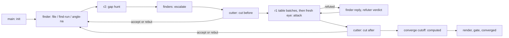

# converge

converge settles the **facts** behind a set of claims. Separate agents find each claim, attack
it, and cut it (rate how much it matters). A CLI validates every step against an
append-only ledger and computes which claims are findings. When the facts are agreed but a
decision remains, the claim carries a `choice` for `debate` (see [engine.md](engine.md)). A
factual dispute never goes to debate.

## Components

| Part | Role |
|---|---|
| `plugins/converge/src/converge/` | Python package: `ledger` (file I/O and common validation), `protocol` (event rules, claim state, batches, phases, cut, result), `model` (replayed slate and claims, rank), `config`, `angles`, `render`, `cli` |
| `plugins/converge/src/converge/angles/builtin.yaml` | Built-in `attack`, `evaluate` and `decide` angles |
| `plugins/converge/bin/converge` | Wrapper: `uv run --project <plugin-root> -m converge.cli` |
| `plugins/converge/skills/converge/` | Orchestration skill (roles, steps, outcomes) |
| `codex-plugins/engine/` | Codex copy: `src/converge/`, `scripts/converge`, `skills/converge/` |

Callers: `review` runs every finding through a slate; the engine `pr-review` and
`ticket-to-pr` machines gate their `review` node on `converge gate`; engine `debate` hands
factual disputes back, briefs parties with the render, and draws its closing angle round from
the `decide` and `attack` angles.

## Slates

A **slate** is one set of claims under test, and one task for the agent budget. Its id
matches `[a-z0-9][a-z0-9._-]{0,80}`. The caller gives the artifact, lenses and find-angle
files. Phases run in a fixed order: find → escalate → cut before → attack → cut after →
cutoff → done.

`init --snapshot --pass N` commits the work tree, untracked files included, through a
temporary index and pins it at `refs/converge/<slate>`. `--since <prev>` requires
`pass = prev.pass + 1`, records the previous snapshot and prints the `git diff` between the
two. From pass 2, a stricter built-in cutoff replaces `report_if` and `report_if_gap_hunt`.
`converge prune` deletes the refs; engine `execute` prunes them before closing a run.

## Roles and angles

- **Declared agent ids** (`--as`). The CLI allows at most `caps.agents` distinct ids per
  slate (default and maximum 5), the `init` writer included; the reserved id `converge`
  does not count. A claim's finder never attacks or cuts it, its refuters and cutters are
  disjoint, and only the finder may `reply`, `rebut` or `accept`. Ids are trusted as
  declared: the checks stop accidental self-judging, not a lying agent.
- **Allocation.** The skill uses `main`, one `finder` for all lenses, `r1`, `r2` and one
  `cutter`; quick review depth drops `r2`. Each agent is spawned once and continued for
  the whole slate. `r2` is also the gap-hunt finder (`origin: gap-hunt`) right after find
  coverage, and acts as finder for those claims. `init --refuters 1` or
  `steps.gap_hunt: false` turns the gap hunt off; it is orchestration, with no event of its
  own. `r1` runs every table batch; `r2` runs the fresh-eye batch, except on claims it filed
  or on a slate with one refuter, where `r1` does.
- **Seats.** Each seat a slate holds (`main`, `finder`, `r1`, `r2`, `cutter`) has a
  mechanism, `native_subagent` or `advisor`. `init --settlement <file>` reads
  `converge_seats` and `advisor_roles` from the engine settlement, re-checks the engine's
  rules (only `r2` may be `advisor`; `refuter` or `gap-hunter` needs
  `r2: advisor`) with a byte-identical copy of the engine's `seats.py`, and records the
  slate's `seats` and the advisor's `{roles, brief}` in the `init` event. Without
  `--settlement`, or when the `init` event has no `seats`, every seat is `native_subagent`. An
  `advisor` `r2` with no advisor role takes `refuter` and `gap-hunter` and a stock brief, with
  a `NOTE`; a settlement `r2: advisor` on a slate without `r2` gets a `NOTE`, not a refusal.
- **Advisor driver.** For an `advisor` seat, `init` and `status` print the driver: one
  background step that sends the request over the advisor channel and starts one
  `receive --timeout 300`, the receive budget, how to discard a late reply, the request
  template whose SCOPE has the listener write its own events with the absolute converge path
  and `--as r2`, and the check that ends the slate `blocked` naming the seat when a write is
  denied or the seat's events are missing. The orchestrator never runs an advisor seat as a
  native subagent.
- **Angles** are rows `{id, tag, tell, asks, field?, lens?, cost?}` with tag `find`,
  `attack`, `evaluate` or `decide`; `(tag, id)` is unique. The built-in table has no `find`
  rows; callers supply them, as review does. The resolved table is builtin + `--angles`
  files + config `angles.files`, minus `angles.disable`. `init` snapshots it, so later edits
  never change an open slate.
- **Coverage.** Every applicable find angle of every lens needs a `find-run` or an
  `angle-na` with a reason.

## Steps, attack and cut

- **Steps.** Config section `steps`: `escalate` and `gap_hunt` (booleans, on by default)
  and `cut` (`before`, `after`, `both` or `none`; default `both`).
- **Phase gate.** `status` reports the slate's phase: the first phase, in the order above,
  with an open item; a cut phase that `steps.cut` excludes is skipped. An event is accepted
  only in the phase of its kind and for a claim with an open item of that phase: `escalate`
  in escalate; `cut`, `accept` and `rebut` in the cut phase their `when` names; `attack`,
  `reply`, `verdict` and a claim-level `angle-na` in attack. `file` is refused once any
  `escalate`, `cut` or `attack` exists, `escalate` once any `cut` or `attack` exists. A
  killed or unverified claim takes no attack and no after cut.
- **Escalate.** Once per claim its finder records `escalate`: a `wider` text with
  `evidence` citing a concrete route to the worse outcome, or neither. A wider text replaces
  the claim text.
- **Cut rounds.** The cutter sets `frequency`, `severity`, `confidence` and `difficulty`,
  each backed by an evaluate angle, with `when` `before` or `after`; a before cut has
  confidence `inferred`. Rounds count per claim and `when`. A next round is refused while
  the latest awaits its finder's `accept` or rebut. A cut track **converges** when the
  finder accepts the latest round, or when the round after a rebut repeats the same four
  values; it is **capped** at `caps.cut_rounds` (5). A `cross-cutting` or `redesign` cut
  carries a `choice`. A claim's ratings are its latest after round, else its latest before
  round.
- **Unverified.** With `steps.cut` `before` or `both`, a claim whose before ratings cut it
  (by the rules below) and that has no `attack` is `unverified`: it is never attacked.
- **Batches.** The attack angles of the snapshot, in order, form fixed table batches of
  `caps.angles_per_claim` (5). A table batch is complete when each of its angles has an
  `attack` or a claim-level `angle-na` on the claim. Then comes one `fresh-eye` batch:
  free-text angles not yet used on the claim, complete after `caps.angles_per_claim` attacks
  or one carrying `last: true`. A claim takes its next batch only when the previous one is
  done; after the fresh-eye batch it is attack-finished.
- **Dispute.** A batch with a `refuted` attack awaits the finder's `reply`: `decline` kills
  the claim; `rebut` carries new evidence (a repeated evidence sha256 for the claim is
  refused) and may carry a clarified `text`, which replaces the claim text. The refuter that
  recorded the first refuted attack then gives a `verdict`: `agree` ends the batch;
  `disagree` carries evidence and awaits a second `reply`, where `decline` kills the claim
  and `rebut` makes it `disputed`.
- **Status.** `killed`, `unverified`, `disputed` or `survived` (initial). Status only
  moves `survived` → `disputed` → `killed`; no event lowers it.
- **Batch plan.** `status --json` prints `plan`: one row per open item of the current
  phase, in rank order, in batches of at most `caps.batch_items` (30). A row is
  `{claim, action, agent_role, batch, angles}`, `action` one of `escalate`, `cut-before`,
  `attack`, `reply`, `verdict`, `cut-after`, `accept`; a table attack row lists the batch's
  open angles, a fresh-eye row the angles already used. The find and the gap hunt are
  exempt.

## Ledger

- One JSONL file per slate, `<dir>/<slate>.jsonl`. `--dir` defaults to
  `~/.bootgear/converge`; review runs use `<session-dir>/converge`.
- Each line is one event `{seq, ts, event, as, ...fields}`. Types: `init`, `file`,
  `escalate`, `find-run`, `angle-na`, `attack`, `reply`, `verdict`, `cut`, `rebut`, `accept`,
  `cutoff`. `seq` is gapless from 1, and `init` is written once, first; it records the
  refuter count (`init --refuters`, 1 or 2). Claims get ids `F001`, `F002`, …; `loc` is
  `path:line`.
- **Write path:** take an exclusive `flock`, replay and validate the whole file, validate
  the new event against the replayed state, append one line, `fsync`. An invalid event is
  rejected whole, with every problem listed.
- **Read path:** every command replays and validates the whole file; one malformed or
  out-of-order line makes every command refuse it. All derived state (claim status,
  batches, cut, rank, phase) is computed on replay, never stored.

## Cutoff and gate

- `converge cutoff` writes the `cutoff` event as agent `converge`; no agent can. It refuses
  while coverage is missing or any claim is open, and every replay re-checks the stored
  rows against a fresh computation.
- **Cut.** Each live claim gets `cut` `yes` or `no` from its ratings. A claim with no
  ratings is `no` (reason `cut none`). Otherwise it is `yes` when no rule of
  `cutoff.report_if` (`report_if_gap_hunt` for gap-hunt claims) matches its ratings, or
  when it ranks past `caps.per_lens` in its lens. A rule maps fields (the four cut fields,
  `origin`, `lens`) to allowed values. `caps.per_lens` maps lens names to caps, with
  `default` (50) for every other lens. Rank is severity, then frequency, then confidence,
  then claim id. A claim whose `rule` is in `cutoff.report_rules` is never cut and takes no
  place in its lens rank. An unverified claim is always `yes`. Killed claims are not rated.
- **Rows.** One per claim, `{claim, status, cut, result, rank, reason}`: `result` is
  `finding` (`cut: no`, not killed), `follow-up` (`cut: yes`) or `killed`. Follow-up claims
  never block the gate or convergence.
- `converge gate <slate> --dir <abs>` exits 0 only when every lens has full coverage, no
  claim is open, and the cutoff is current; it does not require convergence. It requires an
  absolute `--dir`. The engine runs it as the review node's `leave_check` (see
  [state-machine.md](state-machine.md)).
- `converge converged` exits 0 when the slate is done and no claim is `disputed` with
  `cut: no`; otherwise it lists the open and disputed claims.
- `render` builds Markdown from the ledger alone: a summary line with the finding,
  follow-up and killed counts and `converged`, then findings (status and cut), the
  findings' choices, follow-up (status and choice), killed claims with their evidence, and
  coverage.

## Config layers

`converge.yaml` layers deep-merge, later winning: built-in defaults < user
(`~/.claude/converge.yaml`, or `~/.codex/converge.yaml` when `CONVERGE_HOST=codex`) <
project (`<project-root>/.bootgear/config/converge.yaml`) < task (`--config FILE`).
Keys: `cutoff.{report_if, report_if_gap_hunt, report_rules}`,
`caps.{cut_rounds, per_lens, agents, angles_per_claim, batch_items}`,
`steps.{escalate, gap_hunt, cut}`, `angles.{files, disable}`. Unknown keys, bad enum
values, non-positive caps, a `per_lens` that is not a map of positive caps with `default`,
and non-boolean `escalate` or `gap_hunt` are rejected. `init` snapshots the effective
config into the slate.

## Codex bundling

On Claude, converge is its own plugin, and `review` and `engine` declare it as a
dependency. It has no Codex plugin of its own; on Codex it ships inside
`codex-plugins/engine`. `src/converge/` is a byte-identical copy of the package;
`scripts/converge` sets `CONVERGE_HOST=codex` and defaults output to prose;
`skills/converge/SKILL.md` carries the Claude body above `## Host mechanics`, and its host
section spawns native subagents, drives advisor seats through the separately installed
`advisor` plugin, and names the script path. Advisor drivers print the absolute
`scripts/converge` path.
`codex-plugins/engine/tests/test_bundle_drift.py` fails on any drift in the package.
