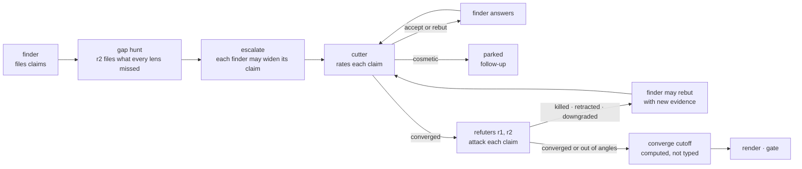

# converge

> **Arguing does not settle facts. Reading and running do.**
> Find it, try to kill it, then rate what survives.

A review produces a list of claims: this call can return null, that branch is unreachable,
this migration loses data. Some are right, some are wrong, and some are true only in a
narrower form. When the agent that found a claim is also the one that judges it, it is
invested in its own finding, and a plausible-sounding false positive reaches the report
unchallenged.

converge separates the parties. One agent finds each claim, different agents try to refute
it, another rates how much it matters, and none of them sees another role's reasoning. A CLI
validates every step against an append-only ledger and **computes** which claims are
reported, so no agent types "reported" into existence.



Default verdicts point against the claim: refute defaults to refuted, cut defaults to cut. A
claim reaches the report only on shown evidence.

---

## Two modes

| Mode | The caller gives | Stages |
|---|---|---|
| `full` | an artifact, lenses, and find-angle files | find → gap hunt → escalate → cut and refute → cutoff |
| `refute-only` | an artifact and a numbered slate of claims | refute only; the render lists each claim's outcome |

A **slate** is one set of claims tested together. `refute-only` is the standalone use: hand it
an existing list of findings and it refutes them until a round changes nothing.

---

## Roles

At most five agents per slate, the orchestrator included. Each role is spawned once and
continued across rounds.

| Role | Agent id | Does |
|---|---|---|
| main | `main` | orchestrates; writes `init`, and in `refute-only` files the slate's claims |
| finder | `finder` | every find angle of every lens (`full` only) |
| refuter | `r1` | attacks each claim with angles not yet used on it |
| refuter | `r2` | like `r1`; also the gap-hunt finder right after the find, unless `steps.gap_hunt` is off |
| cutter | `cutter` | rates every claim (`full` only) |

Each seat runs as a native subagent unless `init --settlement <file>` seats it `advisor` from
an engine settlement; only `r2` may be. An advisor `r2` is the other vendor's host (a Codex or
Claude Code session listening through `advisor`): `init` and `status` print the step that sends
it each round's request and waits for its reply, and a missing listener, denied write or missing
event ends the slate `blocked`, never a native stand-in. `init --refuters 1` drops `r2`.

The CLI enforces the separation: a claim's finder never refutes or cuts it, its refuters and
cutters are disjoint, and only the finder may rebut or accept. Agent ids are declared, so the
checks stop an agent accidentally judging its own work, not a lying one.

---

## Refute: fresh angles until nothing moves

Each refute round uses **attack angles** never used on that claim before —
`boundary`, `reachability`, `guarded-elsewhere`, `positive-control`, `real-referent` and ten
more ship built in (`converge angles --tag attack` lists them). `status` prints a batch plan
that sets how many angles each claim gets per round, at most `caps.angles_per_claim` (5),
in batches of at most `caps.batch_items` (30) items. A quiet round on a reused angle is a
repeat; two fresh angles that change nothing is convergence. A refuter records an angle that
cannot apply to a claim as not applicable.

| Outcome | Meaning |
|---|---|
| `killed` | the claim is false |
| `retracted` | its referent does not exist in the artifact |
| `downgraded` | true only in a narrower form; the narrowed text replaces the claim |
| `survived` | withstood the angle, with evidence cited |
| `inconclusive` | no available source settles it, and the refuter names what would |

A rebuttal must carry new evidence — the CLI hashes it and rejects a repeat. A kill or
downgrade reopens every claim that depends on it. A claim still moving after five rounds, or
with no attack angle left that is unused and applicable, is `unconverged`.

---

## Cut: rate each claim

In `full` mode each claim is cut before it is refuted. First its finder may **escalate** it
once: a wider text, accepted only with evidence citing a concrete route to the worse outcome.
The cutter then sets four fields per claim, each backed by an **evaluate angle**:

| Field | Values |
|---|---|
| `severity` | `security`, `data-loss`, `wrong-behavior`, `degraded`, `cosmetic` |
| `frequency` | `every-call`, `common`, `rare`, `contrived` |
| `confidence` | `reproduced`, `traced`, `inferred` |
| `difficulty` | `trivial`, `local`, `cross-cutting`, `redesign` |

The finder, the party with the opposite stake, answers each round with `accept` or a rebut.
A cut converges on accept, or when the cutter repeats the same values after a rebut; it is
capped at five rounds, shared by first cuts and re-cuts. A refute rebut or a downgrade makes the
cut stale, so the claim is re-cut before its next refute round. When the facts are agreed but a
fix still needs a decision, the claim carries a `choice` — handed on for a decision, never
argued as a fact. A `cosmetic` cut carries a one-line fix and **parks** the claim: it is
never refuted.

`converge cutoff` then sorts every live claim into **reported** or **appendix** from the cut
fields and the configured rules. Inconclusive claims are always reported, and so are
unconverged claims cut `security`, `data-loss` or `wrong-behavior` at `every-call` or `common`
frequency. Cut-capped claims and claims matching a `report_if` rule are reported too, up to
three per lens by default, ranked by severity, then frequency, then confidence. Nothing
verified is dropped — below the line means appendix. Parked claims and the other unconverged
claims are **follow-up**: listed in their own section, labelled `unverified` or
`unconverged`, never as findings, and never blocking the gate.

---

## Commands

| | |
|---|---|
| `/converge:converge` (Codex: `$engine:converge`) | run a slate in `full` or `refute-only` mode through the role agents |

The skill drives the `converge` CLI; on Claude Code the plugin's `bin/` is on `PATH`, on
Codex the skill calls the engine plugin's `scripts/converge`.

```
init        start a slate: mode, lenses, angle files; --snapshot pins the work tree
file        file a claim
escalate    the finder widens a claim with a route to the worse outcome, or declines
find-run    record that a find angle was run
angle-na    record why a find angle, or an attack angle on one claim, does not apply
refute      record one attack angle's outcome on a claim
rebut       the finder answers a refute or cut with new evidence
cut         record a claim's four cut fields
accept      the finder accepts a cut round
status      claims, their refute and cut state, unused angles
converged   whether the refute or cut phase has converged
coverage    which find angles are still unaccounted for
cutoff      compute reported vs appendix
gate        exit 0 only with full coverage, no open claim, a current cutoff
render      Markdown report built from the ledger alone
angles      list the resolved angle table
config      validate or resolve the layered configuration
prune       delete the snapshot refs of finished slates
```

Every command that reads a slate's ledger replays and validates it whole first; one malformed
line makes each of them refuse the slate. `prune` (which only deletes snapshot refs), `angles`
and `config` read no ledger. `--json` or `--prose` picks the output format.

---

## Setup

Prerequisites: `git`, Python 3.11 or later, and [`uv`](https://docs.astral.sh/uv/), which
runs the CLI.

```
/plugin marketplace add vancsj/bootgear
/plugin install converge@bootgear
```

This installs its declared dependencies with it: `memory-ledger` and `advisor`.

On Codex CLI there is no separate install: converge ships inside the `engine` plugin
(`codex plugin add engine@bootgear`).

Ledgers are one JSONL file per slate under `~/.bootgear/converge/` unless `--dir` says
otherwise. Configuration layers deep-merge, later winning: built-in defaults, then the user
file (`~/.claude/converge.yaml`, or `~/.codex/converge.yaml` on Codex), then the project's
`.bootgear/config/converge.yaml`, then a task file passed with `--config`:

```yaml
cutoff:
  report_if: [...]          # field → allowed values; a match is reported
  report_if_gap_hunt: [...] # stricter rules for gap-hunt claims
  report_rules: [...]       # claim rules that are always reported
caps: {refute_rounds: 5, cut_rounds: 5, per_lens: 3, agents: 5, angles_per_claim: 5, batch_items: 30}
steps: {escalate: true, early_cut: true, gap_hunt: true}  # each step can be turned off
angles: {files: [...], disable: [...]}
```

`init` snapshots the effective config and angle table into the slate, so later edits never
change an open one. Design detail: [docs/converge.md](../../docs/converge.md).

---

## Standalone, or as bootgear gear

converge works on its own: `refute-only` needs nothing but an artifact and a list of claims.
Inside bootgear, `review` settles every finding through a `full` slate, `engine` gates its
review step on `converge gate`, and engine's `debate` takes the claims that carry a `choice`.
If `memory-ledger` is installed, refuters consult it for deliberate decisions and converge
records facts that outlive the artifact there; without it, converge notes its absence and
carries on. In an engine run, `clarify` decides which seat the advisor holds, and every slate
the run starts reads that decision from the settlement.
