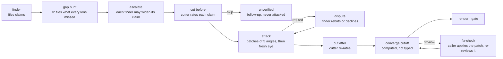

# converge

> **Arguing does not settle facts. Reading and running do.**
> Find it, try to kill it, then rate what survives.

A review produces a list of claims: this call can return null, that branch is unreachable,
this migration loses data. Some are right, some are wrong, and some are true only in a
narrower form. When the agent that found a claim is also the one that judges it, it is
invested in its own finding, and a plausible-sounding false positive reaches the report
unchallenged.

converge separates the parties. One agent finds each claim, different agents try to refute
it, another rates how much it matters, and none of them sees another role's reasoning. A CLI
validates every step against an append-only ledger and **computes** each claim's result, so
no agent types "finding" into existence.



Default verdicts point against the claim: an attack defaults to refuted, a cut defaults to cut. A
claim becomes a finding only on shown evidence.

---

## Roles

A **slate** is one set of claims tested together. At most five agents work on it, the
orchestrator included. Each role is spawned once and continued for the whole slate.

| Role | Agent id | Does |
|---|---|---|
| main | `main` | orchestrates; writes `init` |
| finder | `finder` | every find angle of every lens; answers refutations and cuts of its claims |
| refuter | `r1` | runs every table batch of attack angles |
| refuter | `r2` | runs the fresh-eye batch; also the gap-hunt finder right after the find, unless `steps.gap_hunt` is off |
| cutter | `cutter` | rates every claim |

Each seat runs as a native subagent unless `init --settlement <file>` seats it `advisor` from
an engine settlement; only `r2` may be. An advisor `r2` is the other vendor's host (a Codex or
Claude Code session listening through `advisor`): `init` and `status` print the step that sends
it each request and waits for its reply, and a missing listener, denied write or missing
event ends the slate `blocked`, never a native stand-in. `init --refuters 1` drops `r2`; `r1`
then runs the fresh-eye batch too, as it does for claims `r2` filed.

The CLI enforces the separation: a claim's finder never attacks or cuts it, its refuters and
cutters are disjoint, and only the finder may reply, rebut or accept. Agent ids are declared,
so the checks stop an agent accidentally judging its own work, not a lying one.

---

## Attack: every angle, then fresh eyes

Every claim meets every **attack angle** — `boundary`, `reachability`, `guarded-elsewhere`,
`positive-control`, `real-referent` and ten more ship built in (`converge angles --tag attack`
lists them) — in fixed batches of `caps.angles_per_claim` (5). An angle whose tell does not
apply is recorded not applicable. A last **fresh-eye** batch follows: `r2` is told which angles were used (`used` on its plan
row) and attacks with up to five of its own. A new name is accepted if it is one printable
line without leading or trailing whitespace, including a fixed angle recorded not applicable;
a name already used on the same claim is refused. `status` reports per claim `fixed_remaining`
(fixed angles neither attacked nor not applicable; empty means the fixed set is covered, and
the fresh-eye batch still runs), `na_reasons` (each not-applicable angle with its reason), and
`fresh_eye` (the fresh-eye names attacked on the claim). Names outside the fixed set are listed
slate-wide as `adhoc_angles`, each with its claim and seq.

A refuted batch opens a dispute. The finder rebuts with new evidence (the CLI hashes it and
rejects a repeat), optionally clarifying the claim text, or declines. The refuter then agrees
or disagrees with more evidence, and a disagreement goes back to the finder once more.

| Status | Meaning |
|---|---|
| `survived` | no batch refuted it, or the refuter agreed with the rebut |
| `disputed` | the refuter disagreed and the finder rebutted again |
| `killed` | the finder declined to rebut |
| `unverified` | cut before the attack, so never attacked |

Status only gets worse, `survived` → `disputed` → `killed`; a later clean batch never clears
`disputed`.

---

## Cut: rate each claim

The finder files each claim with its `trigger`, its `evidence` and a `tier`: `reproduced`
(a quoted run shows the trigger), `traced` (file:line for every hop from the entry point to
the effect) or `inferred`. Each finder may then **escalate** its claim once: a wider text,
accepted only with evidence citing a concrete route to the worse outcome.

The cutter rates each claim, every value backed by an **evaluate angle** whose test for that
value it quotes:

| Field | Values |
|---|---|
| `impact` | `security`, `data-loss`, `wrong-output`, `clarity`, `cosmetic` |
| `size` | `many` (at least 2 users or records get a changed result), `one` |
| `reach` | `normal` (a documented caller with valid input), `crafted` (only attacker-supplied input), `unreachable` |
| `rate` | the integer count an evaluate angle with field `rate` asks for; required only when the lens policy has a `rate_at_least` rule, otherwise 0 |
| `difficulty` | `trivial`, `local`, `cross-cutting`, `redesign`; after the attack only |

An after cut also carries the fix as a unified diff (`--patch`), `--callers none|changed` and
`--migration none|needed`. `trivial` and `local` need a patch whose non-test files are only
the claim's loc file, within `cutoff.cheap` (`files`, `lines`, `tests`), with
`callers: none` and `migration: none`; a patch within `trivial_lines` is `trivial`. The CLI
measures the patch itself and refuses a rename, a binary diff or an unparsable patch. A cut
carries a `choice` when the lens's `choice_if` matches, or, while `cutoff.cheap.enabled` is
true, when `difficulty` is `cross-cutting` or `redesign`.

The finder, the party with the opposite stake, answers each round with `accept` or a rebut.
A cut converges on accept, or when the cutter repeats the same values after a rebut; it is
capped at `caps.cut_rounds` (5).

`steps.cut` says when the cutter rates: `before` the attack, `after` it, `both` (the
default) or `none`.

---

## Gates and results

**Gate 1** runs on the before cut: a claim is attacked when its lens's `attack_if` matches
its ratings and tier, or its rule is in `cutoff.report_rules`; otherwise it is `unverified`
and never attacked.

**Gate 2** runs in `converge cutoff` on the latest ratings and status, first match first:

| Result | When |
|---|---|
| `finding` | the claim's rule is in `cutoff.report_rules` |
| `fixed` | its `fix-check` passed |
| `fix-now` | `cutoff.cheap.enabled`, `survived`, and an accepted after cut typed `trivial` or `local` |
| `finding` | the lens's `report_if` matches |
| `follow-up` | otherwise, and every `unverified` claim |
| `killed` | the finder declined to rebut |

A rule maps `impact`, `size`, `reach`, `difficulty`, `tier`, `status`, `origin` or `lens` to
allowed values, and `rate_at_least` to a minimum `rate`. A finding past `caps.per_lens` in its
lens rank (impact, reach, size, rate, tier) becomes a follow-up. Follow-ups are listed and
never block. The slate has **converged** when no finding is `disputed`.

The caller applies each `fix-now` patch, re-reviews only that patch in a new slate, and
records `fix-check` with `pass` (naming that slate, which must hold no finding) or `fail`.
After a failed fix-check the caller reverts the patch, and the claim is a finding or
follow-up by `report_if`.

---

## Commands

| | |
|---|---|
| `/converge:converge` (Codex: `$engine:converge`) | run a slate through the role agents |

The skill drives the `converge` CLI; on Claude Code the plugin's `bin/` is on `PATH`, on
Codex the skill calls the engine plugin's `scripts/converge`.

```
init        start a slate: lenses, angle files, refuters; --snapshot pins the work tree
file        file a claim
escalate    the finder widens a claim with a route to the worse outcome, or declines
find-run    record that a find angle was run
angle-na    record why a find angle, or an attack angle on one claim, does not apply
attack      record one attack angle's outcome on a claim
reply       the finder rebuts or declines a refuted batch
verdict     the refuter agrees or disagrees with the rebut
cut         rate a claim, before or after the attack; an after cut carries the patch
accept      the finder accepts a cut round
rebut       the finder answers a cut round with new evidence
fix-check   the caller records whether an applied fix-now patch passed its re-review
status      phase, plan, and each claim's status, trigger, evidence, tier, result and fix-check
converged   whether the finished slate has no disputed finding
coverage    which find angles are still unaccounted for
cutoff      compute each claim's status, cut and result
gate        exit 0 only with full coverage, no open claim, a current cutoff
render      Markdown report built from the ledger alone; --json adds the fix-now patches
angles      list the resolved angle table
config      validate or resolve the layered configuration
prune       delete the snapshot refs of finished slates
```

Every command that reads a slate's ledger replays and validates it whole first; one malformed
line makes each of them refuse the slate. `prune` (which only deletes snapshot refs), `angles`
and `config` read no ledger. `--json` or `--prose` picks the output format.

---

## Setup

Prerequisites: `git`, Python 3.11 or later, and [`uv`](https://docs.astral.sh/uv/), which
runs the CLI.

```
/plugin marketplace add vancsj/bootgear
/plugin install converge@bootgear
```

This installs its declared dependencies with it: `memory-ledger` and `advisor`.

On Codex CLI there is no separate install: converge ships inside the `engine` plugin
(`codex plugin add engine@bootgear`).

Ledgers are one JSONL file per slate under `~/.bootgear/converge/` unless `--dir` says
otherwise. Configuration layers deep-merge, later winning: built-in defaults, then a calling
skill's file passed with `init --defaults`, then the user file (`~/.claude/converge.yaml`, or
`~/.codex/converge.yaml` on Codex), then the project's `.bootgear/config/converge.yaml`, then
a task file passed with `--config`:

```yaml
cutoff:
  report_rules: [...]       # claim rules that are always findings
  lenses:                   # per lens, else `default`; a rule maps fields to allowed values
    default:
      attack_if: [...]      # gate 1: attack the claim
      report_if: [...]      # gate 2: report it as a finding
      choice_if: [...]      # the after cut needs a choice
  rereview:
    lenses: {...}           # from --pass 2, replaces the named lists of a lens
  cheap: {enabled: true, files: 1, lines: 10, trivial_lines: 3, tests: 1, test_globs: [...]}
caps:
  cut_rounds: 5
  per_lens: {default: 50}   # add a lens key to cap that lens differently
  agents: 5
  angles_per_claim: 5       # attack batch size
  batch_items: 30           # rows per plan batch
steps: {escalate: true, gap_hunt: true, cut: both}  # cut: before | after | both | none
angles: {files: [...], disable: [...]}
```

`init` snapshots the effective config and angle table into the slate, so later edits never
change an open one. Design detail: [docs/converge.md](../../docs/converge.md).

---

## Standalone, or as bootgear gear

converge works on its own: it needs an artifact, lenses and their find-angle files. Inside
bootgear, `review` settles every finding through a slate, `engine` gates its
review step on `converge gate`, and engine's `debate` takes the findings that carry a `choice`.
If `memory-ledger` is installed, refuters consult it for deliberate decisions and converge
records facts that outlive the artifact there; without it, converge notes its absence and
carries on. In an engine run, `clarify` decides which seat the advisor holds, and every slate
the run starts reads that decision from the settlement.
