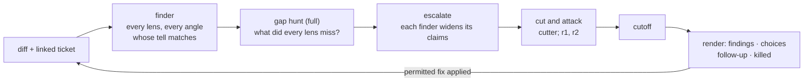

# review

> **A finding is a claim until someone else fails to kill it.**
> Look through every lens, then let converge decide what survives.

An agent reviewing a diff and then checking its own findings is not independent: the
assumption that produced a false positive also approves it. And a review that only reports
what it thinks matters hides everything else it saw, so "no comments" cannot be told apart
from "nothing looked for".

`review` splits the work. One finder looks at the diff through a set of **lenses**, each
with its own **find angles**, and files every claim it makes into a
[converge](../converge) slate. Separate agents attack and rate each claim, and the converge
CLI computes which are findings. Every claim is filed before any cutoff runs, so what falls
below the bar is cut, listed as a follow-up rather than disappearing.



How claims are attacked, rated and cut is converge's job; see its [README](../converge) and
[docs/converge.md](../../docs/converge.md).

## Lenses and depth

| Lens | Depth | Finds |
|---|---|---|
| `correctness` | quick, full | where the code does not do what the change claims, for some reachable input or order of events |
| `tests` | quick, full | changed behaviour no test would catch breaking, and tests that cannot fail |
| `security` | full | a path by which an untrusted input or caller gets an effect or data it should not |
| `architecture` | full | a design choice with a tell in the diff and a cost scenario shown in this repo |
| `simplicity` | full | code the change could drop or shrink with the same behaviour |
| `contract` | full | a caller or consumer that a changed API, schema, CLI, event or file format breaks |
| `consistency` | full | where the change deviates from its peers in naming, structure, error handling, docs or tests, each peer cited |

`quick` runs four agents (main, finder, one refuter, cutter) and no gap hunt. `full`, the
default, adds a second refuter, who first hunts for gaps right after the find, before any
claim is escalated or cut: what every lens missed, and whether the ticket and the diff match
in both directions (asked but missing, present but unasked). An unlabelled call never silently gets the lighter pass.

**Find angles** are specific questions with a *tell*, the sign in the diff that makes the
question worth asking: `changed-contract`, `removed-behavior`, `boundary-input`,
`test-cant-fail`, `ticket-diff` and seven more. The `security`, `tests`, `simplicity` and
`consistency` lenses each add their own angles. The `architecture` lens adds a catalog of 39
design failure patterns (`layer-leak`, `hidden-coupling`, `premature-abstraction`,
`god-object`, ...), each with the cost it makes harder. **Angle packs** are optional angle
files for a kind of project (web, typed OOP, concurrency and database, test tooling); the
review enables the packs whose `# use when:` line fits the project, and `angles.files` and
`angles.disable` in a converge config layer pin or exclude angles. The finder declares the
angles whose tell matches and records every other one as not applicable, so coverage is
checkable.

## Applying feedback

A finding that converge leaves `survived` is real, not accepted. Acceptance is per comment: an explicit
agreement to that comment, or that comment marked resolved as agreed. A question, no reply,
or an overall PR approval does not count. After applying a change, `review` runs the
affected suite and accounts for every in-scope comment as `applied`,
`accepted but not applied`, `rejected or won't-fix`, or `unclear`.

"Apply the accepted comments on this PR" skips the findings pass entirely.

A new review loops (review, apply what the mode permits, re-review) and ends with one outcome:

| Outcome | Means |
|---|---|
| `handoff` | in an engine run whose node has a `fix` edge, the mode would apply at least one claim, or revert a `fix-now` patch whose fix-check failed; review returns the fix list and applies nothing |
| `comment_only` | in an engine run whose node has no `fix` edge; every finding and `fix-now` claim is reported and none applied |
| `clean` | no finding, no `fix-now` claim and no follow-up remains |
| `below_cutoff` | no finding and no `fix-now` claim remains; only cut claims, listed as follow-ups |
| `blocked` | a role or coverage is missing, a finding is `disputed`, or a finding or `fix-now` claim needs an acceptance, a decision or a permission that is not there |
| `no_progress` | the same claim came back unchanged after a fix, with no new information |
| `iteration_cap` | the cap (default 5) ended the loop with live claims |

Under `auto_within_permitted_mutations`, the engine's `fix` node applies only `fix-now`
claims, each by its converge patch, and the next review pass re-reviews just those patches
and records their fix-check. Standalone, the mode is `accepted_only`: nothing is applied
without an outside signal, and `fix-now` claims are reported with the findings.

## Project standard and overrides

A project can commit `.bootgear/config/review-standard.md`: rules headed `## R### [severity]`
with a `severities:` list and a `cutoff:`. The finder tags each claim that breaks a rule, and
a claim tagged with a rule at or above the cutoff is never cut. The brief of every finder,
refuter and cutter also names the standard, the project and user principles files, and in
an `engine` run the settlement's `principles`.

Before its own review, `review` looks for a more specific skill: inside an `engine` run it
reads `review_override` from the settlement (a skill name, or a map keyed by depth);
standalone it uses the current project's own review skill when one fits. See
[docs/README.md](../../docs/README.md).

## Commands

| | |
|---|---|
| `/review:review` (Codex: `$engine:review`) | review a diff, branch or PR, or apply its accepted comments |

## Setup

```
/plugin marketplace add vancsj/bootgear
/plugin install review@bootgear
```

This installs `converge` with it. On Codex CLI, `review` has no separate install: it is
bundled into the Codex `engine` package (`codex plugin add engine@bootgear`).

## Standalone, or as bootgear gear

`review` works on its own, with converge as its one dependency; a standalone caller answers
the claims that carry a `choice` itself. Installed with `engine`, it runs the review step of
a run: `engine` gates leaving that step on `converge gate`, applies the fix list in its `fix`
node, and sends each `choice` to its `review-debate` node.
